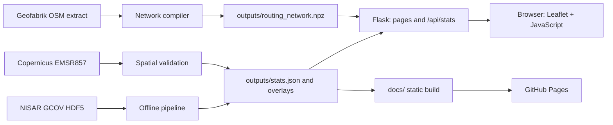

# Architecture

## Overview

The application combines a Leaflet frontend, a Flask server, result artefacts
and offline processing tools.

## Components

- `app/app.py`: HTTP routes, choice of `stats.json`, loading of the route
  engine and the optional tile proxy.
- `app/templates/`: Flask HTML pages. `base.html` holds the head, the warning
  banner, the favicons and the shared scripts; `index.html` (story, `/`) and
  `routes.html` (tool, `/routes`) extend it and share `_masthead.html` (logo
  and page navigation). `/workspace` redirects to `/routes`.
- `app/static/core.js`: what both pages use: the map and basemaps, loading
  `stats.json` and the water layers, the OSM impact map (markers, cards,
  filters) and formatting.
- `app/static/story.js`: the five story screens, the before/during curtain and
  the four-acquisition timeline.
- `app/static/routes.js`: the tool: route planner (car and boat, draggable
  markers, `?to=&from=` links), place search and filter, layer tree and map
  styles in the side panel.
- `app/static/style.css`: application styles.
- `app/static/brand/`: the SARVIA logo and the tab icons.
- `app/static/vendor/leaflet/`: Leaflet served locally.
- `pipeline/`: offline acquisition, reading and analysis of the geospatial
  sources.
- `outputs/`: versioned statistics, overlays and compiled network used at
  runtime.
- `docs/`: pre-built copy of the frontend and the static artefacts used by
  GitHub Pages.

## Dynamic and static execution

### Flask

The browser loads `/api/stats`, overlays under `/outputs/...` and routes from
`POST /api/route`. The route network is loaded on demand and kept in the
process. The app starts on port 5000 when run directly.

Flask also provides `/map-tiles/<provider>/<z>/<x>/<y>` to use tile URLs
configured on the server without exposing tokens in JavaScript.

### GitHub Pages

`pipeline/build_static.py` renders the Flask templates, turns paths into
relative URLs, injects `stats.json` and copies overlays and static files to
`docs/`. It builds `index.html` for the story, `routes.html` for the tool,
the radar reading page and a `workspace.html` that only redirects to
`routes.html`. This publication runs no Python and has no route endpoint or
authenticated tile proxy. Layers, places and filters use the pre-generated
data; the planner is replaced by a link to the live tool, carrying the chosen
destination.

## Interfaces between components

- Frontend and backend share the `stats.json` contract, described in
  [`../stats_contract.md`](../stats_contract.md).
- Network preparation serialises the graph structure into
  `outputs/routing_network.npz`; `pipeline/routing.py` loads that format.
- The EMSR857 validation writes metrics and a difference layer into
  `stats.json` and GeoJSON.
- The OSM impact map writes a category summary and GeoJSON of features and
  road stretches.

## Critical paths

- `app/app.py::stats_path()` prefers `outputs/stats.json` and uses
  `outputs/mock/stats.json` only if the real file is missing.
- `pipeline/build_static.py` refuses to publish if the contract says the data
  are mock.
- The routing state can be inspected with `GET /api/route/status`.
- A `vegetation` layer can be shown through the contract, but it does not
  exist in the current result.
