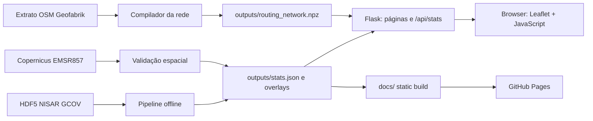

# Arquitetura

## Visão geral

O aplicativo combina um frontend Leaflet, um servidor Flask, artefatos de
resultados e ferramentas de processamento offline.

## Componentes

- `app/app.py`: rotas HTTP, seleção de `stats.json`, carregamento do motor de
  rotas e proxy opcional de tiles.
- `app/templates/`: páginas HTML Flask.
- `app/static/app.js`: navegação da história, mapa, overlays, painel de
  camadas e interface de rotas.
- `app/static/style.css`: estilos da aplicação.
- `app/static/vendor/leaflet/`: Leaflet servido localmente.
- `pipeline/`: obtenção, leitura e análise offline das fontes geoespaciais.
- `outputs/`: estatísticas, overlays e rede compilada versionados usados pelo
  runtime.
- `docs/`: cópia pré-gerada do frontend e dos artefatos estáticos usados pelo
  GitHub Pages.

## Execução dinâmica e estática

### Flask

O browser carrega `/api/stats`, overlays em `/outputs/...` e rotas em
`POST /api/route`. A rede de rotas é carregada sob demanda e guardada no
processo. O app começa na porta 5000 quando executado diretamente.

O Flask também fornece `/map-tiles/<provider>/<z>/<x>/<y>` para usar URLs de
tiles configurados no servidor sem expor tokens no JavaScript.

### GitHub Pages

`pipeline/build_static.py` renderiza os templates Flask, muda os caminhos para
URLs relativas, injeta `stats.json` e copia overlays e arquivos estáticos para
`docs/`. Essa publicação não executa Python nem possui endpoint de rotas ou o
proxy de tiles autenticado. A interface mantém os cinco passos, mas esconde os
controles de cálculo e informa que o passo 5 depende do Flask.

## Interfaces entre componentes

- O frontend e o backend compartilham o contrato `stats.json`, descrito em
  [`../stats_contract.md`](../stats_contract.md).
- A preparação de rede serializa a estrutura do grafo em
  `outputs/routing_network.npz`; `pipeline/routing.py` carrega esse formato.
- A validação EMSR857 grava métricas e camada de diferença no `stats.json` e
  em GeoJSON.
- O mapa de impacto OSM grava resumo de categorias e GeoJSON de feições e
  trechos viários.

## Caminhos críticos

- `app/app.py::stats_path()` prioriza `outputs/stats.json` e usa
  `outputs/mock/stats.json` somente se o arquivo real não estiver presente.
- `pipeline/build_static.py` recusa publicação se o contrato indicar dados
  mock.
- O estado de roteamento pode ser inspecionado por `GET /api/route/status`.
- Uma camada `vegetation` pode ser exibida pelo contrato, mas não existe no
  resultado atual.
